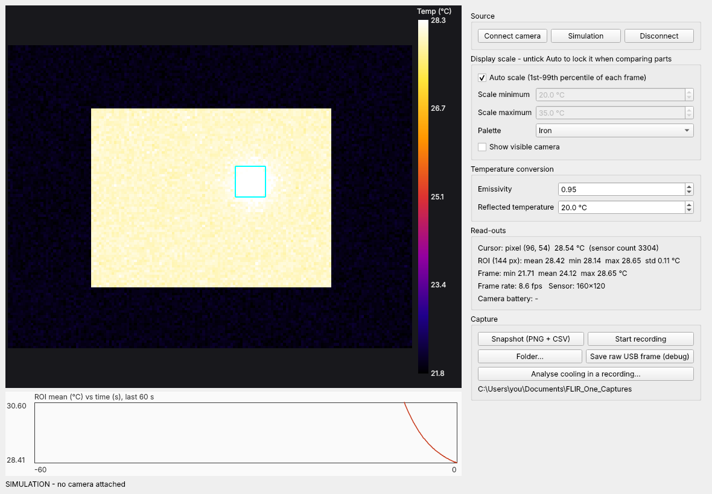
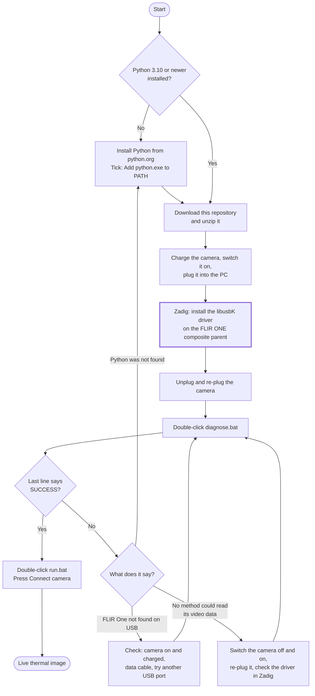
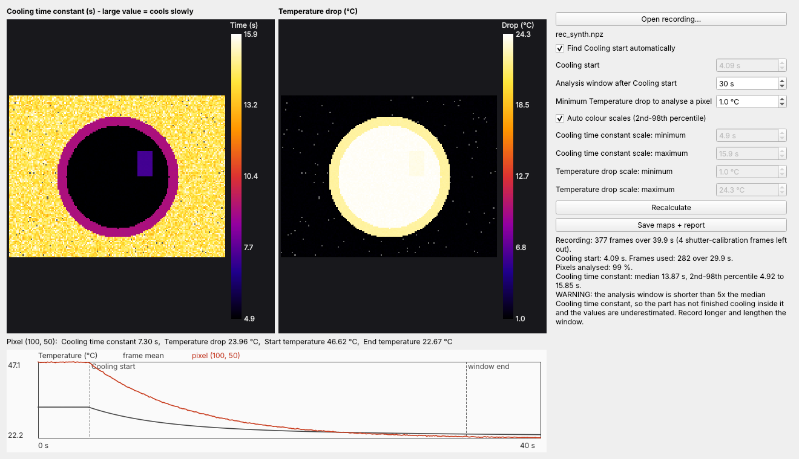

# FLIR One Viewer for Windows

Use a FLIR One USB-C thermal camera directly on a Windows PC: live view, snapshots,
raw recordings and a cooling analysis. No phone and no FLIR app needed.



*The screenshot shows the built-in simulated camera, not a real one.*

> Unofficial project. Not affiliated with or endorsed by Teledyne FLIR. "FLIR" and
> "FLIR One" are trademarks of their owner.

> [!IMPORTANT]
> **You need Zadig before anything else works.** Windows has no driver for this camera.
> You install one, called **libusbK**, with a free tool named [Zadig](https://zadig.akeo.ie).
> It takes about two minutes and you only do it once per PC. Without it the app cannot
> see the camera at all. The exact clicks are in the [setup guide](docs/setup.md#4-install-the-driver-with-zadig).

## What you need

- A Windows PC
- A FLIR One USB-C camera (USB ID `09CB:1996`), charged and switched on
- A USB-C **data** cable or adapter
- [Python 3.10 or newer](https://www.python.org/downloads/)
- [Zadig](https://zadig.akeo.ie), to install the libusbK driver

## Setup at a glance



The Zadig step is the one people miss. Each step is written out in the
[setup guide](docs/setup.md), and [troubleshooting](docs/troubleshooting.md) covers
every failure message.

## Why this exists

The FLIR One is sold as a phone accessory. Plugged into a PC it shows up on USB, but
the usual USB libraries cannot read video from it on Windows. The camera starts its
stream with a command that contradicts its own USB description, and the libraries
react by closing the video channel. This project works around that by talking to the
libusbK driver directly. [How it works](docs/how-it-works.md) has the details.

## Status

| | |
| --- | --- |
| Works on | One FLIR One USB-C camera (USB ID `09CB:1996`, sensor 160 x 120), Windows, Python 3.14, libusbK driver 3.1.0.0 |
| Frame rate | About 9 frames per second |
| Longest logged session | About 5 minutes with no errors |
| Not tested | 80 x 60 models (the decoder supports them), other firmware versions, Linux, macOS |

This has been run on a single camera and a single PC. Expect rough edges, and please
open an issue with your `diagnose_log.txt` if it does not work for you.

## Quick start

1. Install [Python 3.10 or newer](https://www.python.org/downloads/) and tick
   **Add python.exe to PATH**.
2. Download this repository (green **Code** button, **Download ZIP**) and unzip it.
3. Charge the camera, switch it on and plug it into the PC with a data cable.
4. Install the **libusbK** driver for the camera with [Zadig](https://zadig.akeo.ie).
   The exact clicks are in the [setup guide](docs/setup.md).
5. Double-click `diagnose.bat`. It should end with `SUCCESS`.
6. Double-click `run.bat` and press **Connect camera**.

No camera to hand? `run.bat --sim` starts the app with a simulated camera.

## What the app does

- **Live view** with a colour scale you can lock, so the same colour means the same
  temperature across parts.
- **Read-outs** for the pixel under the cursor, a region of interest (ROI) you drag on
  the image, the whole frame, and the camera battery.
- **Snapshot**: a PNG as displayed, a CSV of Temperature per pixel, and the raw sensor
  counts.
- **Recording**: every frame's raw sensor counts with timestamps, in one `.npz` file.
- **Cooling analysis**: turns a heat-then-cool recording into two maps and an HTML report.



*Synthetic recording with a slow-cooling patch and rim built in, not camera data.*

## What the numbers mean

| Name | Meaning | How it is computed |
| --- | --- | --- |
| Sensor count | Raw 16-bit value per pixel from the camera | Read from USB, unmodified |
| Temperature (°C) | Estimated surface temperature | Sensor count x 4, then a Planck-type sensor model with generic FLIR One constants, corrected for Emissivity and Reflected temperature |
| Emissivity | How well the surface radiates compared with an ideal emitter (0 to 1) | You set it; 0.95 suits matte tape, paint and most plastics |
| Reflected temperature (°C) | Temperature of the surroundings mirrored by the surface | You set it; usually room temperature |
| ROI mean (°C) | Average Temperature inside the ROI rectangle | Mean over the ROI pixels of each frame |
| Frame rate (fps) | Frames received per second | From the last 30 frame arrival times |
| Cooling start (s) | When cooling begins in a recording | Last moment the frame-mean Temperature is within 3 % of its peak, or typed in |
| Temperature drop (°C) | How far a pixel cooled | Start temperature minus End temperature (End = mean of the last 2 s of the analysis window) |
| Cooling time constant (s) | How slowly a pixel cools; large = slow | Time to lose 63 % of the Temperature drop, from a straight-line fit to the logarithm of the cooling curve |

**Accuracy.** The temperature constants are generic, not your camera's factory
calibration. Absolute Temperature can be off by a few °C. Differences within an image
and changes over time are more reliable. Do not use this for safety or medical decisions.

## Reading a recording in Python

```python
import numpy as np
from flirone.analysis import load_recording, cooling_analysis

temp, t, info = load_recording("rec_20261110_171500.npz")   # temp: (frames, rows, cols) in °C
result = cooling_analysis(temp, t, window_s=30)
print(np.nanmedian(result["tau"]))                           # Cooling time constant (s)
```

## Repository layout

| Path | What it is |
| --- | --- |
| `app.py` | The window: live view, capture, cooling analysis |
| `diagnose.py` | USB check; run this first |
| `flirone/klib.py` | Direct calls to `libusbK.dll` (the Windows workaround) |
| `flirone/usb_device.py` | Finds the camera, starts the stream, reconnects |
| `flirone/frame.py` | Frame format and temperature conversion; no USB needed |
| `flirone/analysis.py` | Cooling analysis; no USB or window needed |
| `flirone/sim.py` | Simulated camera |
| `tests/` | Tests for the decoder and the analysis (`python tests/test_frame.py`) |
| `run.bat`, `diagnose.bat`, `build_exe.bat` | Launchers; the last one builds a standalone `.exe` |

## Credits

- The USB protocol comes from the community reverse-engineering behind the open-source
  Linux driver `flirone-v4l2`.
- [opportunity-hack/thermaspace.org](https://github.com/opportunity-hack/thermaspace.org)
  confirmed the protocol on real hardware and documented the same wall on macOS.
- [Zadig](https://zadig.akeo.ie) and libusbK provide the Windows driver.

## License

MIT, see [LICENSE](LICENSE). The app uses PySide6 (Qt), which is LGPL-licensed.
