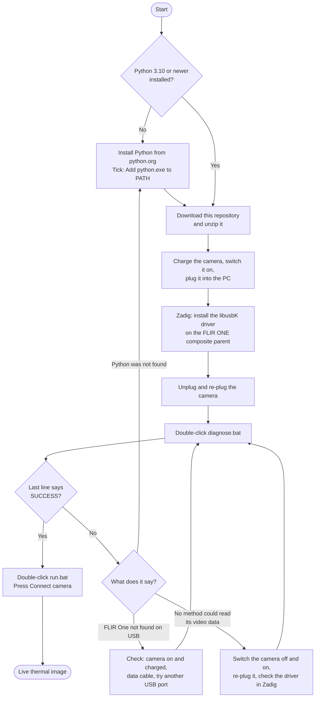

# Setup guide

About 15 minutes the first time. You need a Windows PC, a FLIR One USB-C camera
(USB ID `09CB:1996`) and a USB-C **data** cable or adapter.

## Flowchart



If the diagram does not render where you are reading this, the same picture is in
[images/setup_flowchart.png](images/setup_flowchart.png).

## Step by step

### 1. Install Python

Download Python 3.10 or newer from [python.org](https://www.python.org/downloads/).
In the installer, tick **Add python.exe to PATH** before clicking Install.

### 2. Get the code

On the repository page click **Code**, then **Download ZIP**, and unzip it somewhere
you can find again. Unzip it fully; do not run the files from inside the zip.

### 3. Prepare the camera

- Charge it through its own charging port. The plug that goes into the PC does not
  charge it, as far as we know, and a nearly flat battery can make it drop off USB.
- Switch it on with its power button.
- Plug it into the PC. A charge-only cable will not work.

### 4. Install the driver with Zadig

Windows has no driver for this camera, so you give it a generic one.

1. Download and run [Zadig](https://zadig.akeo.ie).
2. Menu **Options**, tick **List All Devices**.
3. Menu **Options**, untick **Ignore Hubs or Composite Parents**.
4. In the drop-down, pick the FLIR ONE entry whose USB ID is `09CB 1996`. Choose the
   **composite parent**, not an entry named "Interface 0", "Interface 1" or "Interface 2".
5. In the box to the right of the green arrow, choose **libusbK**.
6. Click **Install Driver** (or **Replace Driver**) and wait for it to finish.
7. Unplug the camera and plug it back in.

This also puts `libusbK.dll` on the PC, which the app needs.

### 5. Run the check

Double-click `diagnose.bat`. The first run installs the Python packages, which takes a
few minutes. Then it tries each connection method, waiting 8 seconds between attempts.

A good run ends like this:

```
  [libusbK direct / full] ... OK - received 28 bytes
Using: libusbK direct / full
Layout 160x120; raw counts 3282..3501; temperature 28.1..32.8 degC; JPEG 98072 bytes
27 frame(s), 4422015 bytes in 3.2 s (8.4 frames/s)
SUCCESS - run: python app.py
```

Everything it prints is also saved to `diagnose_log.txt`. If it does not end in
`SUCCESS`, go to [troubleshooting](troubleshooting.md).

### 6. Start the app

Double-click `run.bat` and press **Connect camera**. The image should appear within a
few seconds.

- Drag a rectangle on the image to set the ROI; right-click clears it.
- Untick **Auto scale** and type a minimum and maximum to lock the colour scale.
- `run.bat --sim` starts with a simulated camera, for trying the app without hardware.

### Optional: build a standalone .exe

Double-click `build_exe.bat`. It creates `dist\FlirOneViewer\FlirOneViewer.exe`, which
runs on a PC without Python. The libusbK driver is still needed on that PC.

## Going back

To give the camera back to its original state, open Windows Device Manager, find the
camera, choose **Uninstall device** and tick the option to remove the driver, then
re-plug it.
